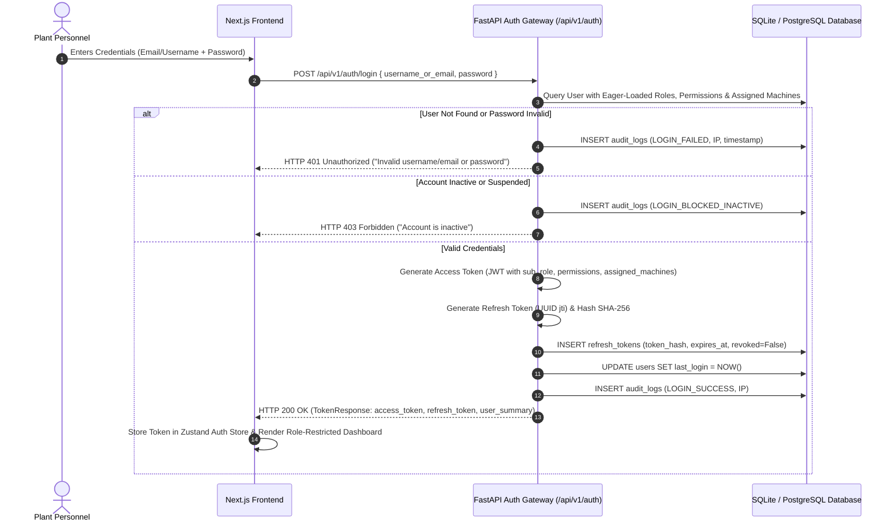

# GreenPulse AI - Enterprise Authentication Architecture

This document specifies the authentication system, credential verification standards, JWT access/refresh token rotation mechanics, session revocation, and security audit logging implemented for the GreenPulse AI platform.

---

## 1. Executive Security Overview

GreenPulse AI implements an enterprise-grade, zero-trust authentication architecture designed for mission-critical manufacturing facilities and industrial SaaS deployments.

### Key Security Standards:
- **Credential Storage**: Passwords are cryptographically salted and hashed using **bcrypt** (12 rounds) with constant-time verification (`hmac.compare_digest`) against timing side-channel attacks. Legacy salted SHA-256 hashes are automatically verified and upgraded upon authentication.
- **Stateless Authorization**: Short-lived **JWT Access Tokens** (HS256) encapsulate identity claims, the user's primary enterprise role, active RBAC permissions, and authorized machine identifiers.
- **Stateful Session Governance**: Cryptographically randomized **Refresh Tokens** stored as SHA-256 hashes in the database enable absolute session revocation and **Refresh Token Rotation**.
- **OAuth2 Password Flow**: Standardized `/api/v1/auth/token` endpoint provides native compatibility with Swagger UI / OpenAPI documentation and industrial API gateways.
- **Immutable Audit Trail**: All authentication events (`LOGIN_SUCCESS`, `LOGIN_FAILED`, `TOKEN_ROTATED`, `LOGOUT`, `USER_CREATED`, `ACCESS_BLOCKED`) are recorded in the `audit_logs` database table with IP addresses, timestamps, and diagnostic metadata.

---

## 2. Authentication Flow



---

## 3. JWT Token Structure & Claims

### 3.1 Access Token Payload

Access tokens are signed using the HMAC-SHA256 (`HS256`) cryptographic algorithm with the enterprise secret key.

```json
{
  "sub": "3",
  "username": "plant_head",
  "email": "plant.head@greenpulse.ai",
  "role": "PLANT_HEAD",
  "permissions": [
    "VIEW_DASHBOARD",
    "VIEW_PLANT",
    "VIEW_MACHINE",
    "VIEW_ASSIGNED_MACHINE",
    "VIEW_DIGITAL_TWIN",
    "VIEW_ENERGY",
    "VIEW_CARBON",
    "VIEW_FORECAST",
    "VIEW_ALERTS",
    "VIEW_RECOMMENDATIONS",
    "APPROVE_RECOMMENDATIONS",
    "VIEW_SIMULATOR",
    "RUN_SIMULATION",
    "VIEW_REPORTS",
    "EXPORT_REPORTS",
    "MANAGE_USERS",
    "CONFIGURE_THRESHOLDS",
    "ACKNOWLEDGE_ALERT",
    "UPDATE_MACHINE_STATUS",
    "SCHEDULE_MAINTENANCE",
    "APPROVE_MAINTENANCE",
    "VIEW_AUDIT_LOGS"
  ],
  "assigned_machines": [
    "air-compressor",
    "cnc-machine",
    "heat-furnace",
    "cooling-pump",
    "paint-booth",
    "assembly-line",
    "cnc-02",
    "comp-02",
    "hvac-01"
  ],
  "type": "access",
  "exp": 1730000000,
  "iat": 1729000000
}
```

### 3.2 Refresh Token Structure

Refresh tokens contain a unique cryptographic identifier (`jti`) and longer expiration:

```json
{
  "sub": "3",
  "type": "refresh",
  "jti": "kX7q2B9_vL5wP8mR1nZ4cT6yA3eD0fG9",
  "exp": 1730604800,
  "iat": 1729000000
}
```

The database stores only `SHA-256(refresh_token)` in the `refresh_tokens` table. In the event of a database breach, raw refresh tokens cannot be reconstructed.

---

## 4. Refresh Token Rotation (RTR)

To protect against token theft, GreenPulse AI enforces **Refresh Token Rotation**:
1. When the client invokes `POST /api/v1/auth/refresh`, the supplied refresh token is validated.
2. The existing refresh token is immediately invalidated in the database (`revoked = True`).
3. A brand-new access token and a brand-new refresh token are generated and returned.
4. If an attacker attempts to replay an already-revoked refresh token, the request is rejected with `HTTP 401 Unauthorized`, and an audit warning is generated.

---

## 5. Pre-Configured Enterprise Personas

For deployment, validation, and multi-persona testing, 4 enterprise users are pre-seeded in the platform:

| Persona | Email / Username | Password | Role Code | Department | Assigned Machines |
| :--- | :--- | :--- | :--- | :--- | :--- |
| **Plant Head** | `plant.head@greenpulse.ai` / `plant_head` | `PlantHead@2026` | `PLANT_HEAD` | Executive Plant Management | All 9 Factory Assets |
| **Energy Manager** | `energy.manager@greenpulse.ai` / `energy_manager` | `EnergyManager@2026` | `ENERGY_MANAGER` | Energy & Sustainability | Plant-Level Scope (All) |
| **Maintenance Manager** | `maintenance.manager@greenpulse.ai` / `maintenance_manager` | `Maintenance@2026` | `MAINTENANCE_MANAGER` | Reliability Engineering | All 9 Factory Assets |
| **Lead Operator** | `operator1@greenpulse.ai` / `operator_lead` | `Operator@2026` | `OPERATOR` | Machining Bay Operations | `COMP-01` & `CNC-01` Only |
| **Administrator** | `admin@greenpulse.ai` / `admin` | `GreenPulse@2026` | `PLANT_HEAD` | Operations Systems | All 9 Factory Assets |

---

## 6. Authentication API Specification

All endpoints are available under the `/api/v1/auth` prefix (and root alias `/auth`).

### 6.1 `POST /api/v1/auth/login`
Authenticates user credentials and returns tokens.
- **Request Body**:
  ```json
  {
    "username_or_email": "plant.head@greenpulse.ai",
    "password": "PlantHead@2026"
  }
  ```
- **Response (HTTP 200)**:
  ```json
  {
    "success": true,
    "data": {
      "access_token": "eyJhbGciOiJIUzI1NiIsIn...",
      "refresh_token": "eyJhbGciOiJIUzI1NiIsIn...",
      "token_type": "bearer",
      "expires_in_seconds": 86400,
      "user": {
        "id": 3,
        "username": "plant_head",
        "email": "plant.head@greenpulse.ai",
        "full_name": "Rajesh Nair",
        "role": "PLANT_HEAD",
        "department": "Executive Plant Management",
        "status": "active",
        "is_active": true,
        "is_admin": true,
        "assigned_machines": ["air-compressor", "cnc-machine", "..."],
        "permissions": ["VIEW_DASHBOARD", "VIEW_PLANT", "..."]
      }
    },
    "message": "Authentication successful. Welcome, Rajesh Nair."
  }
  ```

### 6.2 `POST /api/v1/auth/token`
OAuth2 Password flow specification endpoint for Swagger UI Authorize button.
- **Content-Type**: `application/x-www-form-urlencoded`
- **Fields**: `username`, `password`

### 6.3 `POST /api/v1/auth/refresh`
Rotates refresh tokens and issues a fresh session pair.
- **Request Body**: `{ "refresh_token": "eyJhbG..." }`

### 6.4 `POST /api/v1/auth/logout`
Revokes active refresh tokens and logs security audit trail.
- **Headers**: `Authorization: Bearer <access_token>`

### 6.5 `GET /api/v1/auth/me`
Returns authenticated user profile, roles, permissions, and assigned machinery.
- **Headers**: `Authorization: Bearer <access_token>`

### 6.6 `POST /api/v1/auth/register` (Admin Only)
Registers a new platform user. Restricted to users with `MANAGE_USERS` permission.
- **Request Body**:
  ```json
  {
    "username": "operator_sharma",
    "email": "p.sharma@greenpulse.ai",
    "password": "SecurePassword@2026",
    "full_name": "Pooja Sharma",
    "role": "OPERATOR",
    "department": "Machining Bay 2",
    "assigned_machine_ids": ["cnc-02"]
  }
  ```

### 6.7 `GET /api/v1/auth/audit-logs` (Plant Head Only)
Retrieves immutable compliance audit logs. Restricted to `VIEW_AUDIT_LOGS` permission.

---

## 7. Swagger / OpenAPI Integration

To test authenticated endpoints in the interactive Swagger documentation:
1. Navigate to `http://127.0.0.1:8000/docs` in your browser.
2. Click the green **Authorize** button at the top right.
3. Enter `plant.head@greenpulse.ai` (or `plant_head`) and password `PlantHead@2026`.
4. Click **Authorize**. All subsequent test requests will automatically include the `Authorization: Bearer <token>` header.
