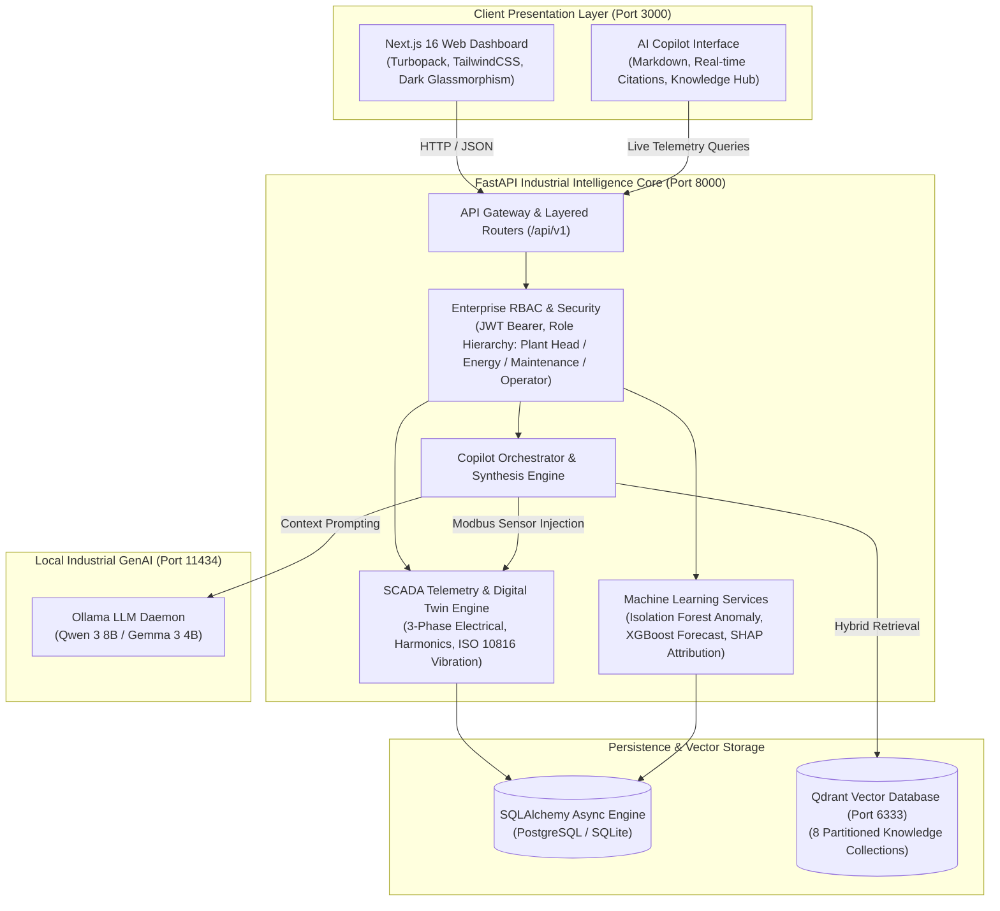

# GreenPulse AI — Enterprise Industrial Energy Intelligence & Sustainability Platform

[](docker-compose.yml)
[](https://nextjs.org/)
[](https://fastapi.tiangolo.com/)
[](https://qdrant.tech/)
[](https://ollama.com/)
[]()
[]()

> **GreenPulse AI** is an enterprise-grade industrial energy intelligence, predictive asset health, and decarbonization platform designed for heavy manufacturing facilities, power generation plants, and thermal processing bays. Modeled after world-class industrial automation architectures (*Siemens Simatic Energy Manager*, *Schneider Electric EcoStruxure*, *Honeywell Forge*, and *ABB Ability™*), GreenPulse unites real-time SCADA Modbus telemetry, unsupervised anomaly detection, multi-horizon load forecasting, and local GenAI Copilot (RAG) into a single operational interface.

---

## 1. System Architecture



---

## 2. Key Modules & Capabilities

### ⚡ Executive Industrial Dashboard
- **Real-Time KPIs**: Live facility power demand, active machine counts, daily cumulative consumption (kWh), power factor, and blended electricity costs.
- **Contract Demand Interlock**: Continuous monitoring against the facility's **2,500 kW Contracted Maximum Demand (CMD)** with automated multi-stage alerts (Stage-1 advisory at 85%, Stage-2 warning at 92%, Stage-3 mandatory curtailment at 95%).
- **Time-of-Day (ToD) Tariff Optimization**: Peak tariff multiplier monitoring (1.44x penalty window between 18:00 – 22:00; off-peak rebate window between 22:00 – 06:00).

### 🏭 Digital Twin & Machine Fleet Telemetry
- **Full Electrical Diagnostics**: 3-phase currents ($I_R, I_Y, I_B$), line-to-neutral voltages ($V_R, V_Y, V_B$), frequency, total harmonic distortion (THD-V / THD-I compliant with IEEE 519), and reactive power ($kVAR$).
- **Thermal & Mechanical Health**: Bearing temperature telemetry and vibration velocity RMS monitored in strict accordance with **ISO 10816 vibration severity zones** (Zone A: Good through Zone D: Unacceptable / Trip).
- **Asset Scope**: Arc Furnaces (`FURN-01`), Rotary Compressors (`COMP-01`, `COMP-02`), 5-Axis CNC Milling Centers (`CNC-01`, `CNC-02`), HVAC Chillers (`HVAC-01`), and High-Pressure Slurry Pumps (`PUMP-01`).

### 🔮 Predictive Load Forecasting & Explainable AI (XAI)
- **Multi-Horizon 24-Hour Forecast**: Predictive hourly load curves modeling weather shifts, production dispatch plans, and historical diurnal variance.
- **Quantile Confidence Bounds**: Upper ($P_{95}$) and lower ($P_{80}$) probability bands for peak exposure mitigation.
- **TreeExplainer SHAP Attribution**: Quantifies variance contributions from ambient temperature, production volume, power factor, and tariff schedules.

### 🚨 Unsupervised Anomaly Detection & Incident Triage
- **Isolation Forest Engine**: Multivariate anomaly scoring identifying abnormal power draw spikes, harmonic contamination, and bearing thermal runaway.
- **Incident Lifecycle Management**: One-click technician acknowledgment, severity categorization (CRITICAL / WARNING / ADVISORY), and automated maintenance work-order dispatch.

### 🌿 GHG Protocol Carbon Accounting & Net-Zero Tracking
- **Scope 1 (Direct)**: Natural gas furnaces and diesel generator fuel emissions.
- **Scope 2 (Indirect)**: Purchased grid electricity calculated using official Central Electricity Authority (CEA) grid emission factors ($0.82\text{ kg CO}_2\text{e/kWh}$).
- **Renewable Displacement**: Real-time rooftop solar PV offset accounting and BRSR / ISO 50001 audit export reports.

### 🤖 Industrial AI Copilot (Qdrant RAG + Local Ollama LLM)
- **Enterprise Vector Knowledge Hub**: 8 partitioned collections indexed in Qdrant:
  1. `company_sops`: Peak demand curtailment, power factor penalty mitigation.
  2. `machine_manuals`: OEM manuals, critical fault codes (EDT, motor unbalance).
  3. `government_schemes`: BEE PAT Cycle VI, ESCerts trading rules.
  4. `iso_50001`: Energy Performance Indicators (EnPI) and Significant Energy Uses (SEUs).
  5. `maintenance_docs`: ISO 10816 vibration severity guidelines and PM intervals.
  6. `energy_policies`: Factory net-zero roadmap, procurement standards.
  7. `industrial_standards`: IEEE 519 harmonic limits, power quality norms.
  8. `uploaded_pdfs`: On-demand PDF/DOCX/TXT document ingestion with automatic text splitting and embedding generation.
- **Grounding & Persona**: Powered by local `qwen3:8b` (with Gemma 3 fallback) via Ollama. Fuses live SCADA telemetry registers directly into context.
- **Strict Provenance**: Generates transparent document citations with exact document title, page numbers, and vector similarity relevance percentages.
- **Resilient Fallback Engine**: If the local LLM is offline, a deterministic industrial synthesis engine extracts relevant manual excerpts and live telemetry registers so operations never stall.

### 🛡️ Enterprise Role-Based Access Control (RBAC)
- **4 Hierarchical Roles**:
  - `PLANT_HEAD`: Full factory visibility, capital ECM approvals, financial budgets, and executive exports.
  - `ENERGY_MANAGER`: Tariff analytics, ToD curtailment scheduling, carbon accounting, and BEE compliance.
  - `MAINTENANCE_MANAGER`: Machine digital twin, vibration spectra, incident acknowledgment, and work-order dispatch.
  - `OPERATOR`: Scoped exclusively to assigned machinery on the shop floor; financial budgets and global settings are automatically restricted.
- **Workstation Scoping**: JWT Bearer token authentication with machine assignment validation and audit trail logging.

---

## 3. Technology Stack

| Layer | Component | Description |
|---|---|---|
| **Frontend UI** | Next.js 16.4.3 | Turbopack, React 19, TypeScript, Lucide Icons, Recharts, TailwindCSS |
| **State Management** | Zustand | Client-side reactive session, role persistence, and token handling |
| **Backend API** | FastAPI 0.115+ | Python 3.11/3.12, Clean Architecture, Pydantic v2 validation |
| **ORM & DB** | SQLAlchemy 2.0 (Async) | Supports SQLite (frictionless development) and PostgreSQL (`asyncpg`) |
| **Vector Database** | Qdrant v1.12.0 | High-performance vector search engine partitioned across 8 collections |
| **Embeddings** | HuggingFace BAAI/bge-m3 | 384-dim semantic embeddings for technical documents and manual diagrams |
| **Local LLM** | Ollama (`qwen3:8b`) | Local inference with zero external cloud dependencies or API keys required |
| **Machine Learning** | Scikit-learn & Joblib | Isolation Forest anomaly detection, compressed model artifacts |
| **Containerization** | Docker Compose | Multi-container microservices network with persistent volume storage |

---

## 4. Directory Structure

```
GreenPulse-KPCL/
├── docker-compose.yml                     # Unified multi-service production stack
├── .env.example                           # Global environment template
├── .gitignore                             # Clean repository ignore specification
├── AUTHENTICATION.md                      # Security, JWT tokens, and RBAC implementation
├── DOCKER_DEPLOYMENT.md                   # Container orchestration guide
├── ROLE_PERMISSION_MATRIX.md              # Complete role-to-endpoint access matrix
├── README.md                              # Main platform documentation
│
├── green-pulse-ai-design/                 # Frontend Web Application (Next.js 16)
│   ├── app/                               # Next.js App Router pages
│   │   ├── copilot/page.tsx               # Industrial AI Copilot console
│   │   ├── digital-twin/page.tsx          # Real-time machine fleet twin
│   │   ├── ai-forecast-center/page.tsx    # 24h predictive load forecast
│   │   ├── anomaly-center/page.tsx        # Isolation Forest incident triage
│   │   ├── recommendation-center/page.tsx # Prescriptive ECM payback viewer
│   │   ├── carbon-accounting/page.tsx     # GHG Protocol Scope 1/2 tracking
│   │   └── plant-overview/page.tsx        # High-level manufacturing plant KPIs
│   ├── components/                        # Reusable UI component library
│   │   ├── modules/copilot/               # Copilot chat view, knowledge collections
│   │   └── shared/                        # Sidebar, headers, floating widgets
│   ├── Dockerfile                         # Multi-stage optimized Node.js runner
│   ├── next.config.mjs                    # Turbopack rewrites & proxy routing
│   └── package.json                       # Dependencies (React 19, Recharts, Tailwind)
│
└── green-pulse-ai-design/backend/         # Industrial Intelligence Core (FastAPI)
    ├── app/
    │   ├── api/                           # Layer 1: FastAPI endpoint controllers
    │   │   ├── copilot.py                 # RAG chat, document upload & collections
    │   │   ├── dashboard.py               # Plant overview & executive summary
    │   │   ├── machines.py                # 3-Phase electrical & thermal telemetry
    │   │   ├── forecast.py                # Predictive energy & cost forecasts
    │   │   ├── anomaly.py                 # Anomaly triage & work order dispatch
    │   │   └── carbon.py                  # Scope 1 & 2 carbon accounting
    │   ├── copilot/                       # AI Copilot Core Engine
    │   │   ├── copilot_service.py         # Multi-branch RAG & SCADA orchestrator
    │   │   ├── ollama_service.py          # Local LLM connector (Qwen 3 8B)
    │   │   ├── vector_store.py            # Qdrant client & similarity search
    │   │   ├── embedding_service.py       # Local transformer embedding generator
    │   │   ├── ingestion.py               # Document loader, chunker & indexer
    │   │   └── intent_classifier.py       # Natural language intent detection
    │   ├── core/                          # Infrastructure & security
    │   │   ├── config.py                  # Pydantic BaseSettings & env configs
    │   │   ├── database.py                # Async database engine & session pool
    │   │   └── dependencies.py            # JWT authentication & role guards
    │   ├── ml/                            # Machine learning model interfaces
    │   ├── models/                        # Layer 4: SQLAlchemy ORM entities
    │   ├── repositories/                  # Layer 3: Database query access objects
    │   └── services/                      # Layer 2: Domain orchestration services
    ├── knowledge_documents/               # Seed industrial SOPs, OEM manuals & standards
    ├── trained_models/                    # Serialized ML model artifacts (.joblib)
    ├── Dockerfile                         # Python 3.11 production container
    └── requirements.txt                   # Locked Python dependencies
```

---

## 5. Quick Start with Docker (Recommended)

### Prerequisites
- [Docker Desktop](https://www.docker.com/products/docker-desktop/) (v24.0+ recommended)
- [Ollama](https://ollama.com/) running on your host machine with `qwen3:8b`:
  ```bash
  ollama run qwen3:8b
  ```

### 1. Launch Full Stack
From the project root directory, run:
```bash
docker compose up --build -d
```

Docker Compose will automatically:
1. Initialize the **Qdrant Vector Database** on port `6333` and verify health.
2. Build and launch the **FastAPI AI Backend** on port `8000`, seed database tables, generate embeddings, and index 67 industrial knowledge chunks across 8 Qdrant collections.
3. Build and launch the **Next.js 16 Production Frontend** on port `3000`.

### 2. Access the Application
| Service | URL | Credentials / Notes |
|---|---|---|
| **Web Dashboard** | [http://localhost:3000](http://localhost:3000) | Full UI & Consoles |
| **AI Copilot** | [http://localhost:3000/copilot](http://localhost:3000/copilot) | Natural Language RAG Assistant |
| **API Documentation** | [http://localhost:8000/docs](http://localhost:8000/docs) | Interactive Swagger UI |
| **API Health Check** | [http://localhost:8000/health](http://localhost:8000/health) | Backend & Database Status |
| **Qdrant Vector DB** | [http://localhost:6333/dashboard](http://localhost:6333/dashboard) | Web Vector Collection Viewer |

### 3. Pre-Configured Test Accounts
Use the user switcher in the top navigation bar or authenticate with:
- **Plant Head**: `plant_head` (Full access across all plant metrics)
- **Energy Manager**: `energy_manager` (Tariffs, ECM recommendations, carbon tracking)
- **Maintenance Manager**: `maintenance_manager` (Machine twins, vibration, alert triage)
- **Operator**: `operator_lead` (Scoped exclusively to assigned machines)

---

## 6. Local Development (Without Docker)

### Backend Setup
```bash
cd green-pulse-ai-design/backend

# Create and activate virtual environment
python -m venv .venv
# Windows:
.venv\Scripts\activate
# Linux/macOS:
source .venv/bin/activate

# Install dependencies
pip install -r requirements.txt

# Start backend server
uvicorn app.main:app --host 0.0.0.0 --port 8000 --reload
```

### Frontend Setup
```bash
cd green-pulse-ai-design

# Install dependencies
npm install --legacy-peer-deps

# Start Next.js development server
npm run dev
```

---

## 7. Compliance & Standards Adherence

- **ISO 50001:2018**: Standardized Energy Baselines (EnB) and Energy Performance Indicators (EnPI) tracked per production bay.
- **GHG Protocol Corporate Standard**: Accurate Scope 1 (Direct Fuel) and Scope 2 (Location-Based Grid Electricity) carbon footprint quantification.
- **IEEE 519-2022**: Harmonic voltage distortion limits ($THD < 5\%$) and current distortion analysis.
- **ISO 10816-3**: Mechanical vibration severity grading (Velocity RMS in mm/s) for rotating machinery.
- **BEE PAT Scheme Cycle VI**: Specific Energy Consumption (SEC) tracking and Energy Saving Certificates (ESCerts) forecasting.

---

## 8. License & Acknowledgments

Developed for the **KPCL Hackathon 2026**.
Architected for industrial reliability, explainable manufacturing operations, and real-time energy decarbonization.
