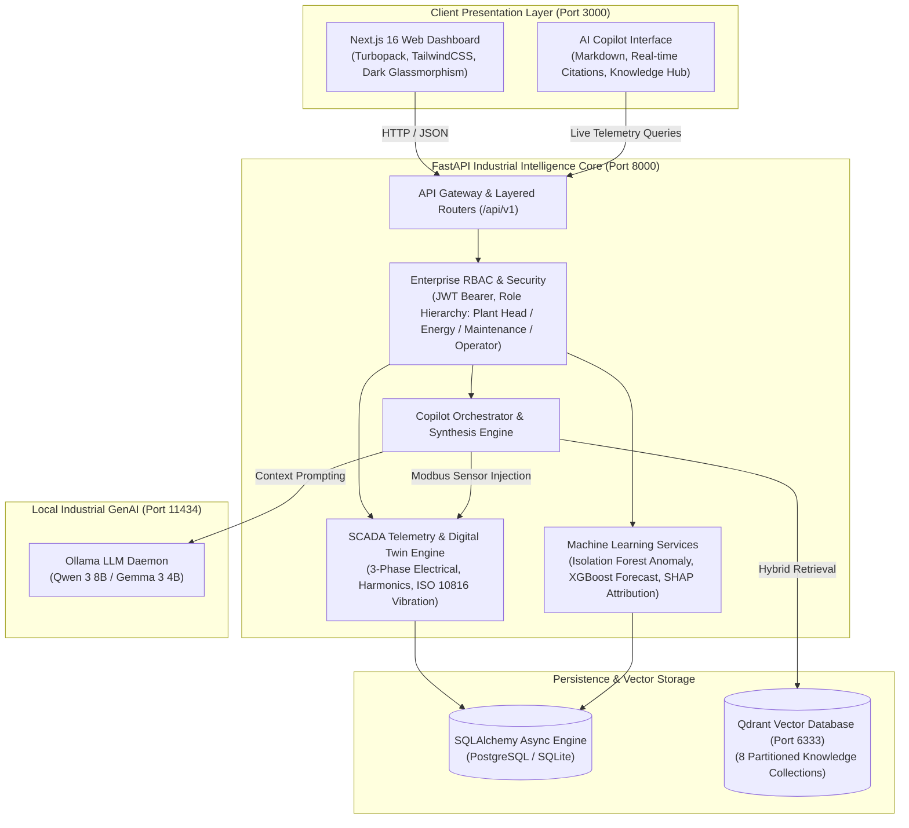
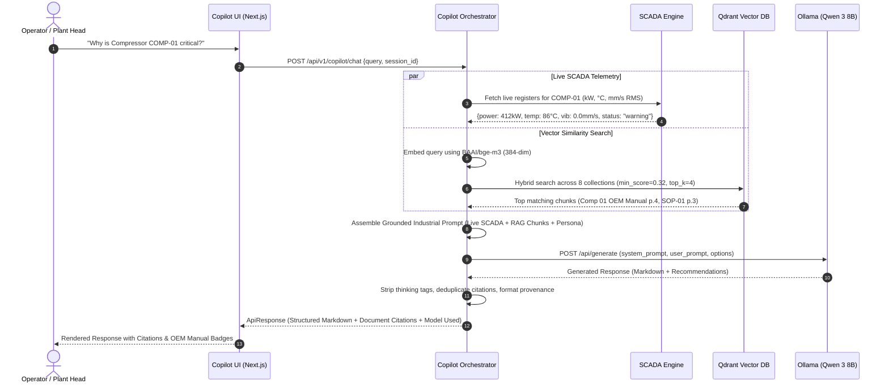

# GreenPulse AI — Enterprise Industrial Energy Intelligence & Sustainability Platform

[](docker-compose.yml)
[](https://nextjs.org/)
[](https://fastapi.tiangolo.com/)
[](https://qdrant.tech/)
[]()
[](https://ollama.com/)
[]()
[]()

> **GreenPulse AI** is an enterprise-grade industrial energy intelligence, predictive asset health, and decarbonization platform designed for heavy manufacturing facilities, power generation plants, and thermal processing bays. Modeled after world-class industrial automation architectures (*Siemens Simatic Energy Manager*, *Schneider Electric EcoStruxure*, *Honeywell Forge*, and *ABB Ability™*), GreenPulse unites real-time SCADA Modbus telemetry, unsupervised anomaly detection, multi-horizon load forecasting, and local GenAI Copilot (RAG) into a single operational interface.

---

## 1. System Architecture



---

## 2. 🧠 Industrial RAG (Retrieval-Augmented Generation) & GenAI Copilot

GreenPulse AI features an industrial-grade **Retrieval-Augmented Generation (RAG)** pipeline purpose-built for heavy manufacturing and utility operations. It guarantees zero-hallucination operational advice by grounding every response in verified factory Standard Operating Procedures (SOPs), machine OEM manuals, and compliance standards while injecting live SCADA Modbus telemetry registers directly into the context window.



### 📚 Partitioned Vector Knowledge Collections (Qdrant)
The knowledge base is partitioned into **8 distinct collections** in Qdrant, containing **67+ pre-indexed vector points** with support for on-demand document ingestion:

| Collection Name | Title | Chunks | Description & Indexed Sources |
|---|---|---|---|
| `company_sops` | Company SOPs | 12 | Plant Peak Demand Curtailment (`SOP-01`), Power Factor Correction (`SOP-02`), Stage 1/2/3 load shedding. |
| `machine_manuals` | Machine Manuals | 11 | OEM manuals for Rotary Screw Compressors (`COMP-01`), Arc Furnaces, CNC Milling Centers, EDT alarm codes. |
| `government_schemes` | Government Schemes | 6 | BEE PAT Scheme Cycle VI, Specific Energy Consumption (SEC) targets, ESCerts compliance and trading. |
| `iso_50001` | ISO 50001 Documents | 5 | Energy Management Systems, Energy Performance Indicators (EnPI), Energy Baselines (EnB), SEU identification. |
| `maintenance_docs` | Maintenance Docs | 4 | ISO 10816 vibration severity limits (Zones A–D), predictive bearing maintenance, lubrication schedules. |
| `energy_policies` | Energy Policies | 4 | Plant #4 Net-Zero Roadmap, renewable procurement norms, BRSR compliance guidelines. |
| `industrial_standards`| Industrial Standards | 5 | IEEE 519-2022 harmonic voltage distortion limits ($THD < 5\%$), power factor penalty thresholds ($PF < 0.95$). |
| `uploaded_pdfs` | Uploaded Documents | 20+ | Dynamic on-demand ingestion: *GreenPulse Plant 4 Master Operational Manual.pdf*, custom user manuals. |

### 🛠️ Key RAG Features
1. **Dynamic Live Modbus Fusion**: When an operator queries equipment status, live electrical draw (kW), bearing temperatures (°C), and vibration (mm/s RMS) from the Digital Twin are automatically injected alongside the OEM manual troubleshooting section.
2. **Transparent Provenance & Citation Tracking**: Every response references the exact document title, page number, section heading, and similarity score percentage. Citations are deduplicated by `(document, page)`.
3. **Local GenAI with Zero Cloud Dependency**: Driven by local **Ollama (`qwen3:8b`)**, running completely on-premise without external API keys or cloud data exposure.
4. **Resilient Dual-Engine Fallback**: If the local LLM is undergoing model loading or offline, the backend's deterministic **Grounded Industrial Synthesis Engine** immediately formats the retrieved RAG manual excerpts and live SCADA registers, ensuring 100% operational uptime.
5. **Thinking Tag Elimination**: Automatically filters internal reasoning tags (`<think>...</think>`) produced by thinking models (such as Qwen 3 or DeepSeek), delivering crisp, structured Markdown sections:
   - `### Summary`
   - `### Detailed Explanation`
   - `### OEM Manual & Operational Protocols`
   - `### Recommended Actions`
   - `### Sources & Data Provenance`

---

## 3. 🐳 Complete Docker & Container Architecture

GreenPulse AI is distributed as an enterprise-grade, multi-container Docker Compose microservices stack designed for high availability, isolated networking, and persistent data storage.

```
                      ┌────────────────────────────────────────┐
                      │          Host Machine Ports            │
                      └───────┬──────────────┬──────────┬──────┘
                              │              │          │
                              ▼ :3000        ▼ :8000    ▼ :6333
┌────────────────────────────────────────────────────────────────────────┐
│  Docker Bridge Network: greenpulse-network                             │
│                                                                        │
│   ┌────────────────────────┐         ┌──────────────────────────────┐  │
│   │  greenpulse-frontend   │         │     greenpulse-backend       │  │
│   │  (Next.js 16.4.3)      ├────────►│     (FastAPI 0.115+)         │  │
│   │  Turbopack / Node 20   │ HTTP    │     Python 3.11-slim         │  │
│   └────────────────────────┘         └──────────────┬───────────────┘  │
│                                                     │                  │
│                                                     ▼ HTTP             │
│                                      ┌──────────────────────────────┐  │
│                                      │     greenpulse-qdrant        │  │
│                                      │     (Qdrant v1.12.0)         │  │
│                                      │     Vector Database          │  │
│                                      └──────────────┬───────────────┘  │
└─────────────────────────────────────────────────────┼──────────────────┘
                                                      │
                                                      ▼ Host Gateway
                                       ┌──────────────────────────────┐
                                       │ host.docker.internal:11434   │
                                       │ (Local Ollama LLM Daemon)    │
                                       └──────────────────────────────┘
```

### 📦 Services & Container Matrix

| Container Name | Base Image | Host Port | Internal Port | Healthcheck | Purpose |
|---|---|---|---|---|---|
| `greenpulse-frontend` | `node:20-alpine` | `3000:3000` | `3000` | Process exit / HTTP 200 | Next.js 16 Web Dashboard, Copilot UI, Recharts, Turbopack |
| `greenpulse-backend` | `python:3.11-slim`| `8000:8000` | `8000` | `curl -f http://localhost:8000/health` | FastAPI core, ML engines, RAG pipeline, SQLite/PostgreSQL |
| `greenpulse-qdrant` | `qdrant/qdrant:v1.12.0`| `6333:6333`<br>`6334:6334` | `6333` (HTTP)<br>`6334` (gRPC) | TCP socket connect on `6333` | Vector database storing 8 collections & 67+ knowledge chunks |

### 💾 Persistent Volumes
- `greenpulse_qdrant_storage`: Retains vector indexes, point payloads, and collection configurations across container restarts.
- `greenpulse_backend_uploads`: Persists uploaded operational manuals, PDFs, and user documents.
- `greenpulse_backend_storage`: Stores embedded sqlite database files, audit logs, and cache.

### 🚀 One-Command Docker Commands

#### 1. Start the entire platform in the background:
```bash
docker compose up --build -d
```

#### 2. Check container status & healthchecks:
```bash
docker compose ps
```
*Expected output: All 3 containers in `Up (healthy)` state.*

#### 3. View unified real-time logs:
```bash
# All services:
docker compose logs -f

# Backend only:
docker compose logs -f backend

# Frontend only:
docker compose logs -f frontend

# Qdrant only:
docker compose logs -f qdrant
```

#### 4. Restart individual microservices:
```bash
docker compose restart backend
docker compose restart frontend
```

#### 5. Stop the stack:
```bash
# Stop containers (preserves volumes and data):
docker compose down

# Stop containers and remove all persistent volumes (fresh reset):
docker compose down -v
```

---

## 4. Key Platform Modules & Capabilities

### ⚡ Executive Industrial Dashboard
- **Real-Time KPIs**: Live facility power demand, active machine counts, daily cumulative consumption (kWh), power factor, and blended electricity costs.
- **Contract Demand Interlock**: Continuous monitoring against the facility's **2,500 kW Contracted Maximum Demand (CMD)** with automated multi-stage alerts (Stage-1 advisory at 85%, Stage-2 warning at 92%, Stage-3 mandatory curtailment at 95%).
- **Time-of-Day (ToD) Tariff Optimization**: Peak tariff multiplier monitoring (1.44x penalty window between 18:00 – 22:00; off-peak rebate window between 22:00 – 06:00).

### 🏭 Digital Twin & Machine Fleet Telemetry
- **Full Electrical Diagnostics**: 3-phase currents ($I_R, I_Y, I_B$), line-to-neutral voltages ($V_R, V_Y, V_B$), frequency, total harmonic distortion (THD-V / THD-I compliant with IEEE 519), and reactive power ($kVAR$).
- **Thermal & Mechanical Health**: Bearing temperature telemetry and vibration velocity RMS monitored in strict accordance with **ISO 10816 vibration severity zones** (Zone A: Good through Zone D: Unacceptable / Trip).
- **Asset Scope**: Arc Furnaces (`FURN-01`), Rotary Compressors (`COMP-01`, `COMP-02`), 5-Axis CNC Milling Centers (`CNC-01`, `CNC-02`), HVAC Chillers (`HVAC-01`), and High-Pressure Slurry Pumps (`PUMP-01`).

### 🔮 Predictive Load Forecasting & Explainable AI (XAI)
- **Multi-Horizon 24-Hour Forecast**: Predictive hourly load curves modeling weather shifts, production dispatch plans, and historical diurnal variance.
- **Quantile Confidence Bounds**: Upper ($P_{95}$) and lower ($P_{80}$) probability bands for peak exposure mitigation.
- **TreeExplainer SHAP Attribution**: Quantifies variance contributions from ambient temperature, production volume, power factor, and tariff schedules.

### 🚨 Unsupervised Anomaly Detection & Incident Triage
- **Isolation Forest Engine**: Multivariate anomaly scoring identifying abnormal power draw spikes, harmonic contamination, and bearing thermal runaway.
- **Incident Lifecycle Management**: One-click technician acknowledgment, severity categorization (CRITICAL / WARNING / ADVISORY), and automated maintenance work-order dispatch.

### 🌿 GHG Protocol Carbon Accounting & Net-Zero Tracking
- **Scope 1 (Direct)**: Natural gas furnaces and diesel generator fuel emissions.
- **Scope 2 (Indirect)**: Purchased grid electricity calculated using official Central Electricity Authority (CEA) grid emission factors ($0.82\text{ kg CO}_2\text{e/kWh}$).
- **Renewable Displacement**: Real-time rooftop solar PV offset accounting and BRSR / ISO 50001 audit export reports.

### 🛡️ Enterprise Role-Based Access Control (RBAC)
- **4 Hierarchical Roles**:
  - `PLANT_HEAD`: Full factory visibility, capital ECM approvals, financial budgets, and executive exports.
  - `ENERGY_MANAGER`: Tariff analytics, ToD curtailment scheduling, carbon accounting, and BEE compliance.
  - `MAINTENANCE_MANAGER`: Machine digital twin, vibration spectra, incident acknowledgment, and work-order dispatch.
  - `OPERATOR`: Scoped exclusively to assigned machinery on the shop floor; financial budgets and global settings are automatically restricted.
- **Workstation Scoping**: JWT Bearer token authentication with machine assignment validation and audit trail logging.

---

## 5. Technology Stack

| Layer | Component | Description |
|---|---|---|
| **Frontend UI** | Next.js 16.4.3 | Turbopack, React 19, TypeScript, Lucide Icons, Recharts, TailwindCSS |
| **State Management** | Zustand | Client-side reactive session, role persistence, and token handling |
| **Backend API** | FastAPI 0.115+ | Python 3.11/3.12, Clean Architecture, Pydantic v2 validation |
| **ORM & DB** | SQLAlchemy 2.0 (Async) | Supports SQLite (frictionless development) and PostgreSQL (`asyncpg`) |
| **Vector Database** | Qdrant v1.12.0 | High-performance vector search engine partitioned across 8 collections |
| **RAG Embeddings** | HuggingFace BAAI/bge-m3 | 384-dim semantic embeddings for technical documents and manual diagrams |
| **Local LLM** | Ollama (`qwen3:8b`) | Local inference with zero external cloud dependencies or API keys required |
| **Machine Learning** | Scikit-learn & Joblib | Isolation Forest anomaly detection, compressed model artifacts |
| **Containerization** | Docker Compose | Multi-container microservices network with persistent volume storage |

---

## 6. Directory Structure

```
GreenPulse-KPCL/
├── docker-compose.yml                     # Unified multi-service production stack
├── .env.example                           # Global environment template
├── .gitignore                             # Clean repository ignore specification
├── AUTHENTICATION.md                      # Security, JWT tokens, and RBAC implementation
├── DOCKER_DEPLOYMENT.md                   # Container orchestration guide
├── ROLE_PERMISSION_MATRIX.md              # Complete role-to-endpoint access matrix
├── README.md                              # Main platform documentation
│
├── green-pulse-ai-design/                 # Frontend Web Application (Next.js 16)
│   ├── app/                               # Next.js App Router pages
│   │   ├── copilot/page.tsx               # Industrial AI Copilot console
│   │   ├── digital-twin/page.tsx          # Real-time machine fleet twin
│   │   ├── ai-forecast-center/page.tsx    # 24h predictive load forecast
│   │   ├── anomaly-center/page.tsx        # Isolation Forest incident triage
│   │   ├── recommendation-center/page.tsx # Prescriptive ECM payback viewer
│   │   ├── carbon-accounting/page.tsx     # GHG Protocol Scope 1/2 tracking
│   │   └── plant-overview/page.tsx        # High-level manufacturing plant KPIs
│   ├── components/                        # Reusable UI component library
│   │   ├── modules/copilot/               # Copilot chat view, knowledge collections
│   │   └── shared/                        # Sidebar, headers, floating widgets
│   ├── Dockerfile                         # Multi-stage optimized Node.js runner
│   ├── next.config.mjs                    # Turbopack rewrites & proxy routing
│   └── package.json                       # Dependencies (React 19, Recharts, Tailwind)
│
└── green-pulse-ai-design/backend/         # Industrial Intelligence Core (FastAPI)
    ├── app/
    │   ├── api/                           # Layer 1: FastAPI endpoint controllers
    │   │   ├── copilot.py                 # RAG chat, document upload & collections
    │   │   ├── dashboard.py               # Plant overview & executive summary
    │   │   ├── machines.py                # 3-Phase electrical & thermal telemetry
    │   │   ├── forecast.py                # Predictive energy & cost forecasts
    │   │   ├── anomaly.py                 # Anomaly triage & work order dispatch
    │   │   └── carbon.py                  # Scope 1 & 2 carbon accounting
    │   ├── copilot/                       # AI Copilot Core Engine
    │   │   ├── copilot_service.py         # Multi-branch RAG & SCADA orchestrator
    │   │   ├── ollama_service.py          # Local LLM connector (Qwen 3 8B)
    │   │   ├── vector_store.py            # Qdrant client & similarity search
    │   │   ├── embedding_service.py       # Local transformer embedding generator
    │   │   ├── ingestion.py               # Document loader, chunker & indexer
    │   │   └── intent_classifier.py       # Natural language intent detection
    │   ├── core/                          # Infrastructure & security
    │   │   ├── config.py                  # Pydantic BaseSettings & env configs
    │   │   ├── database.py                # Async database engine & session pool
    │   │   └── dependencies.py            # JWT authentication & role guards
    │   ├── ml/                            # Machine learning model interfaces
    │   ├── models/                        # Layer 4: SQLAlchemy ORM entities
    │   ├── repositories/                  # Layer 3: Database query access objects
    │   └── services/                      # Layer 2: Domain orchestration services
    ├── knowledge_documents/               # Seed industrial SOPs, OEM manuals & standards
    ├── trained_models/                    # Serialized ML model artifacts (.joblib)
    ├── Dockerfile                         # Python 3.11 production container
    └── requirements.txt                   # Locked Python dependencies
```

---

## 7. Quick Start & Execution

### Prerequisites
- [Docker Desktop](https://www.docker.com/products/docker-desktop/) (v24.0+ recommended)
- [Ollama](https://ollama.com/) running on your host machine with `qwen3:8b`:
  ```bash
  ollama run qwen3:8b
  ```

### 1. Launch Full Stack with Docker
From the project root directory, run:
```bash
docker compose up --build -d
```

### 2. Access the Application
| Service | URL | Description |
|---|---|---|
| **Web Dashboard** | [http://localhost:3000](http://localhost:3000) | Full Industrial UI & Operations Consoles |
| **AI Copilot (RAG)** | [http://localhost:3000/copilot](http://localhost:3000/copilot) | Natural Language Industrial Assistant |
| **API Documentation** | [http://localhost:8000/docs](http://localhost:8000/docs) | Interactive Swagger UI API Docs |
| **API Health Check** | [http://localhost:8000/health](http://localhost:8000/health) | Backend & Database Status Probe |
| **Qdrant Vector DB** | [http://localhost:6333/dashboard](http://localhost:6333/dashboard) | Web Vector Collection Viewer |

### 3. Pre-Configured Test Roles
Use the role selector in the top bar or sign in with:
- **Plant Head**: `plant_head` (Full plant-wide visibility, financial budgets, approvals)
- **Energy Manager**: `energy_manager` (Tariffs, ECM recommendations, carbon accounting)
- **Maintenance Manager**: `maintenance_manager` (Machine twins, vibration, alert triage)
- **Operator**: `operator_lead` (Scoped exclusively to assigned production machinery)

---

## 8. Compliance & Standards Adherence

- **ISO 50001:2018**: Standardized Energy Baselines (EnB) and Energy Performance Indicators (EnPI) tracked per production bay.
- **GHG Protocol Corporate Standard**: Accurate Scope 1 (Direct Fuel) and Scope 2 (Location-Based Grid Electricity) carbon footprint quantification.
- **IEEE 519-2022**: Harmonic voltage distortion limits ($THD < 5\%$) and current distortion analysis.
- **ISO 10816-3**: Mechanical vibration severity grading (Velocity RMS in mm/s) for rotating machinery.
- **BEE PAT Scheme Cycle VI**: Specific Energy Consumption (SEC) tracking and Energy Saving Certificates (ESCerts) forecasting.

---

## 9. License & Acknowledgments

Developed for the **KPCL Hackathon 2026**.
Architected for industrial reliability, explainable manufacturing operations, and real-time energy decarbonization.
