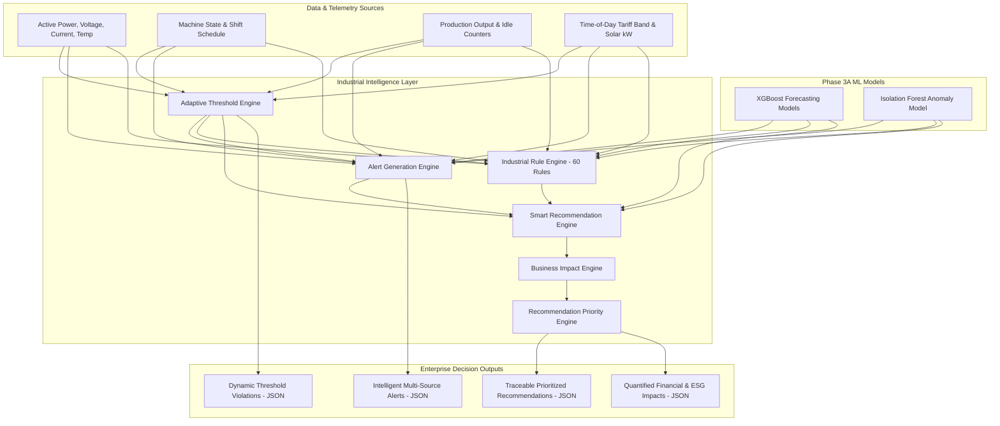

# GreenPulse AI - Industrial Intelligence Layer

The **Industrial Intelligence Layer** transforms raw machine learning predictions (forecasts and anomaly scores) into explainable, traceable, domain-grounded industrial decisions.

Rather than merely outputting `Energy = 1825 kWh` or an abstract anomaly score `-0.065`, the system acts as an experienced Plant Energy Manager and Automation Engineer:
- **WHY**: Identifies root causes (e.g. unloader valve diaphragm blowby, peak tariff collision, suction strainer cavitation).
- **WHAT IT MEANS**: Translates sensor excursions into financial expenditure (₹/hr, ₹/month), MDI contract penalties, and Scope 2 carbon footprints.
- **WHAT SHOULD BE DONE**: Prescribes concrete, actionable engineering steps (e.g. valve overhaul kit GA-355, APFC capacitor step energization, Shift C batch rescheduling).
- **EXPECTED IMPACT**: Quantifies direct financial ROI, monthly/annual savings, avoided line stoppages, and ESG audit score gains.

---

## 1. Architecture & Component Hierarchy



---

## 2. Core Engines Overview

### 1. Adaptive Threshold Engine (`services/threshold_engine.py`)
Never relies on globally static numbers. Automatically adapts statistical bounds ($\mu \pm k \cdot \sigma$) using:
- **Equipment Profile**: Rated capacity, normal idle baseline, thermal operating window
- **Department**: Thermal inertia, continuous vs. batch cadence
- **Diurnal Timing & Shift**: Shift A (1.0x), Shift B (0.95x), Shift C (0.80x), Weekend standby (0.30x)
- **Production Level & Machine Utilization**: Dynamic load factor scaling
- **Confidence Calibration**: Statistical stability index based on variance and sample continuity

### 2. Alert Generation Engine (`services/alert_engine.py`)
Combines multi-modal signals into composite industrial alerts:
- **Contractual Demand Protection**: 85% Warning (212.5 kW) and 95% Critical (237.5 kW) against 250 kW contract limit
- **Isolation Forest Telemetry Anomalies**: Catches multi-dimensional excursions invisible to single sensors
- **Unexpected Standby Energy**: Detects parasitic loads during unloader idle or non-working weekends
- **Power Quality & Grid Surcharges**: Power factor $< 0.90$, voltage sags $< 385\ \text{V}$, harmonic pollution
- **Production Decoupling**: Alerts when machines draw 40%+ rated load with 0 parts produced

### 3. Industrial Rule Engine (`services/rule_engine.py` & `services/config/rule_registry.py`)
Encapsulates **60 industrial business rules** across 6 reusable modules:
1. `EnergyEfficiencyRules` (Rules 1–10): Idle power cut-off, unloader blowby, compressed air header trimming, refractory door radiant loss, weekend ghost load de-energization, economizer free-cooling, etc.
2. `TariffOptimizationRules` (Rules 11–20): High-power furnace peak window delay, chilled water thermal storage pre-cooling, off-peak shift C batch annealing, peak tariff machine start interlock, solar self-consumption maximization, etc.
3. `EquipmentHealthRules` (Rules 21–30): Pump suction strainer cavitation, compressor discharge overheating, spindle bearing micro-vibration, motor 3-phase current imbalance, excessive motor starts/hour, VFD harmonic ripple, etc.
4. `DemandManagementRules` (Rules 31–40): Contracted maximum demand 85%/95% thresholds, soft-starter compliance, low power factor penalty prevention, substation voltage sag tap-changing, sliding window predictive peak breach, etc.
5. `CarbonSustainabilityRules` (Rules 41–50): High grid carbon dispatch throttling, hourly carbon emission budget tracking, specific carbon per part exceedance, rooftop solar curtailment prevention, fugitive refrigerant leak detection, etc.
6. `ProductionAlignmentRules` (Rules 51–60): Specific Energy Consumption (SEC kWh/unit) deterioration, energy consumed with zero parts produced, shift changeover energy coasting, half-empty furnace batch under-utilization, scrap rate surge energy multiplier, etc.

### 4. Smart Recommendation Engine (`services/recommendation_engine.py`)
Ensures **100% traceability**. Every recommendation explicitly documents:
- **Why it was generated**: Triggered observations and sensor values
- **Contributing models**: XGBoost forecast targets, Isolation Forest anomaly score
- **Exceeded thresholds**: Lower/upper dynamic thresholds breached
- **Supporting rule IDs**: Specific industrial rules satisfied
- **Business vs Technical explanation**: Plain language for plant executives + technical details for maintenance engineers

### 5. Business Impact Engine (`services/business_impact_engine.py`)
Calculates rigorous plant operational numbers:
- Monthly & Annual OPEX Savings (INR)
- Avoided Unplanned Downtime Cost (INR)
- Scope 2 Carbon Abatement ($kg\ CO_2e$ & Tonnes $CO_2e$)
- Payback Period & Capital Expenditure ROI (%)
- ESG & ISO 50001 Governance Points

### 6. Recommendation Priority Engine (`services/priority_engine.py`)
Multi-Criteria Decision Analysis (MCDA) prioritizing recommendations by:
$$\text{Priority Score} = 0.25 S_{\text{safety}} + 0.20 F_{\text{financial}} + 0.15 E_{\text{energy}} + 0.10 C_{\text{carbon}} + 0.10 R_{\text{roi}} + 0.10 K_{\text{criticality}} + 0.10 P_{\text{confidence}}$$

---

## 3. Directory Layout

```
services/
├── __init__.py                     # Package entry point
├── threshold_engine.py             # Adaptive Threshold Engine
├── alert_engine.py                 # Intelligent Alert Generation Engine
├── rule_engine.py                  # Industrial Rule Engine (60 Rules)
├── recommendation_engine.py        # Traceable Recommendation Engine
├── business_impact_engine.py       # Financial, Carbon & Downtime Impact Engine
├── priority_engine.py              # Multi-Criteria Priority Ranking Engine
└── config/
    ├── __init__.py                 # Configuration package entry point
    ├── industrial_constants.py     # Tariffs, shifts, carbon factors, MDI limits
    ├── department_config.py        # 6 plant departments & cost centers
    ├── machine_config.py           # 8 equipment engineering baselines
    ├── threshold_config.py         # Statistical weights, z-scores, idle timeouts
    └── rule_registry.py            # 60 Battle-tested Industrial Rules
```

---

## 4. Verification & Testing

Run the test suite to validate all 6 engines across multi-source operational scenarios:

```powershell
.\backend\.venv\Scripts\python.exe test_intelligence_layer.py
```

Results are verified and saved in [`results/intelligence_demonstration.json`](file:///c:/Users/Sarthak%20kokadwar/Documents/COLLEGE%20FILES/SEM_5/KPCL_Hackathon/green-pulse-ai-design/results/intelligence_demonstration.json).
